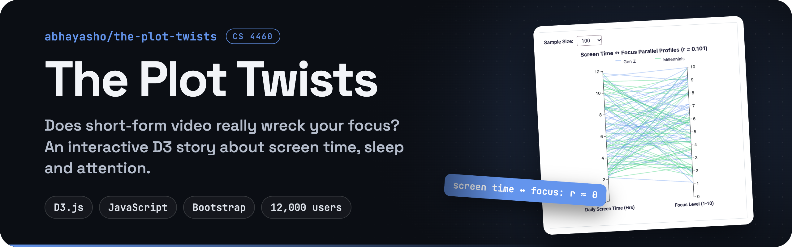
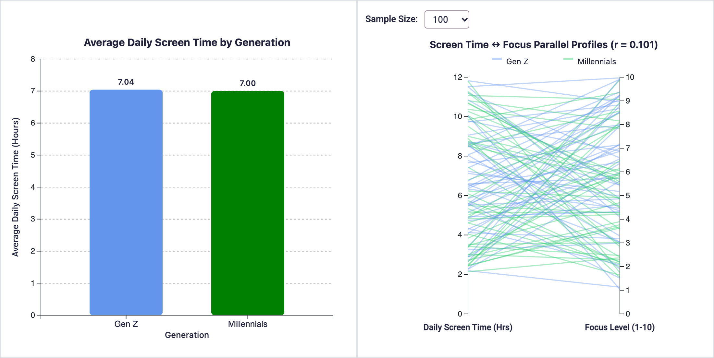
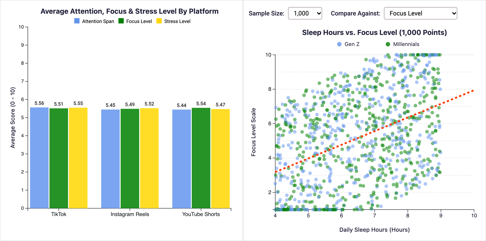
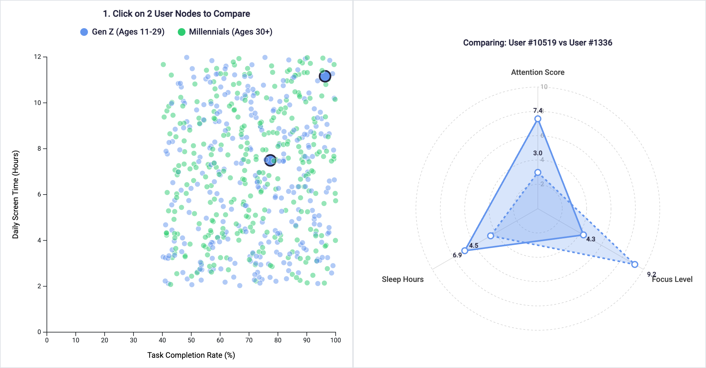
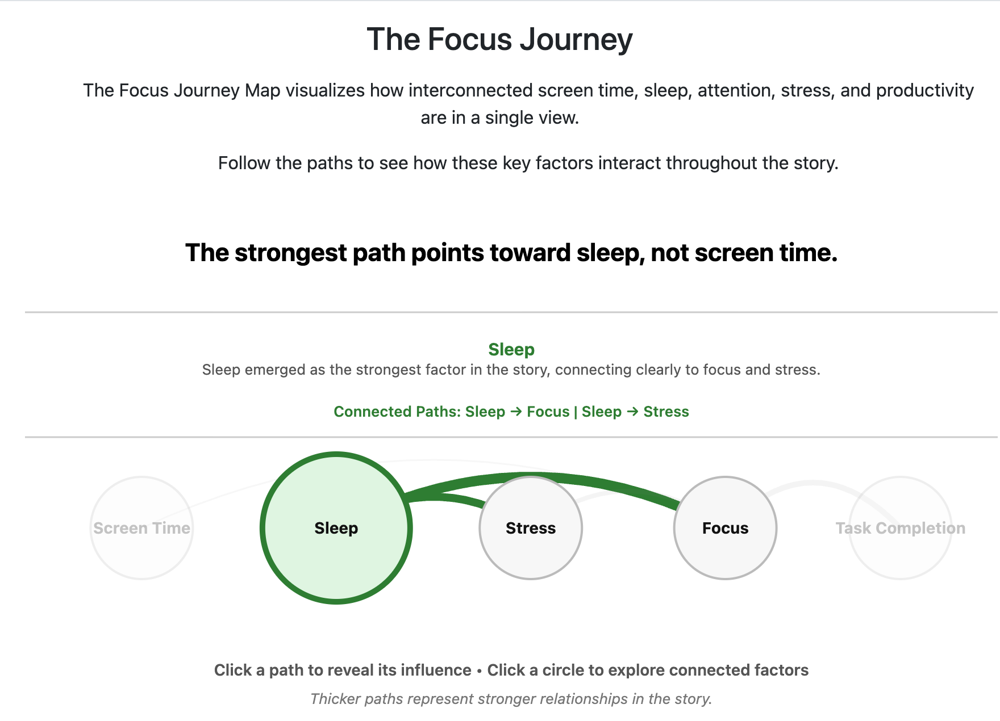

<p align="center">
  
</p>

<p align="center">
  
  
  
  
</p>

**The Plot Twists** is an interactive data story built for **CS 4460 (Information Visualization) at Georgia Tech**. It starts from a popular belief, that short-form video is destroying our attention spans, and explores it with seven linked D3 views over a dataset of 12,000 users of TikTok, Instagram Reels and YouTube Shorts.

**Team:** Pratham, Jada and Abhay

> [!NOTE]
> **About the findings.** The screen-time result holds up: daily screen time has essentially no correlation with focus in this dataset (r ≈ 0.00 across all 12,000 rows). The dashboard's sleep storyline does not come from the raw data, though:
>
> - The **Sleep Hours vs. Metric** chart adds `(sleep_hours − 7) × 0.95` (0.90 for stress) to each user's score before plotting and fitting the trend line. In the raw data, sleep has no meaningful correlation with focus (r ≈ −0.01), attention span (r ≈ 0.00) or stress (r ≈ 0.01).
> - The connection strengths in the **Focus Journey** map are set by hand to illustrate the narrative, not computed from the data.
>
> Read the sleep sections as a demonstration of the storytelling and interaction techniques rather than as an empirical result.

## The views

### 1. Screen time vs. focus

<p align="center">
  
</p>

Gen Z and Millennials average almost the same daily screen time (about 7 hours). The parallel-profiles chart connects each sampled user's screen time to their focus level. The lines cross every which way, and the correlation is close to zero. A dropdown changes how many users are drawn.

### 2. Platforms and sleep

<p align="center">
  
</p>

Attention, focus and stress average out nearly identically across TikTok, Instagram Reels and YouTube Shorts. The scatter plot puts sleep hours against focus, attention span or stress (switchable with a dropdown) with a fitted trend line. Its upward trend comes from the sleep adjustment described in the note above.

### 3. Productivity explorer

<p align="center">
  
</p>

Task completion rate against daily screen time. Productive users show up at every level of screen time. Click any two points to compare those users side by side on a radar chart of attention score, focus level and sleep hours.

### 4. The Focus Journey map

<p align="center">
  
</p>

A node-link diagram of the story's factors: screen time, sleep, stress, focus and task completion. Click a path to read its annotation, or click a factor to highlight everything connected to it. Path thickness reflects the narrative's claims (see the note above).

## The data

`data/reels_attention_span_dataset_12000.csv` has 12,000 rows, one per user:

| Column | Description |
| --- | --- |
| `age` | 15–44, grouped into Gen Z (11–29) and Millennials (30–45) |
| `platform` | TikTok, Instagram Reels or YouTube Shorts |
| `reels_watch_time_hours` | Daily short-form watch time (0.5–6 h) |
| `daily_screen_time_hours` | Total daily screen time (2–12 h) |
| `sleep_hours` | Nightly sleep (4–9 h) |
| `attention_span_score` | Attention score (1–10) |
| `focus_level` | Focus level (1–10) |
| `stress_level` | Low, Medium or High |
| `task_completion_rate` | Share of tasks completed (40–100%) |

Across the full dataset, every pair of these measures has a correlation near zero (|r| < 0.03, with stress coded Low = 1, Medium = 2, High = 3). Several charts draw a random sample of users to keep the SVGs responsive, so the r values shown on the charts change a little between page loads.

## Run it locally

There's no build step. Serve the folder with any static HTTP server, since the browser needs to fetch the CSV:

```bash
git clone https://github.com/abhayasho/the-plot-twists.git
cd the-plot-twists
python3 -m http.server 8000
```

Then open **http://localhost:8000**. D3 and Bootstrap load from a CDN, so you need an internet connection.

## Built with

- [D3.js v7](https://d3js.org) for every chart and interaction
- [Bootstrap 5.1](https://getbootstrap.com) for layout
- Plain HTML, CSS and JavaScript

```
the-plot-twists/
├── index.html     story text and chart containers
├── js/main.js     data loading and all seven D3 views
├── css/style.css  custom styles
└── data/          the 12,000-row dataset
```

Originally built and hosted on Georgia Tech's GitHub Enterprise.
